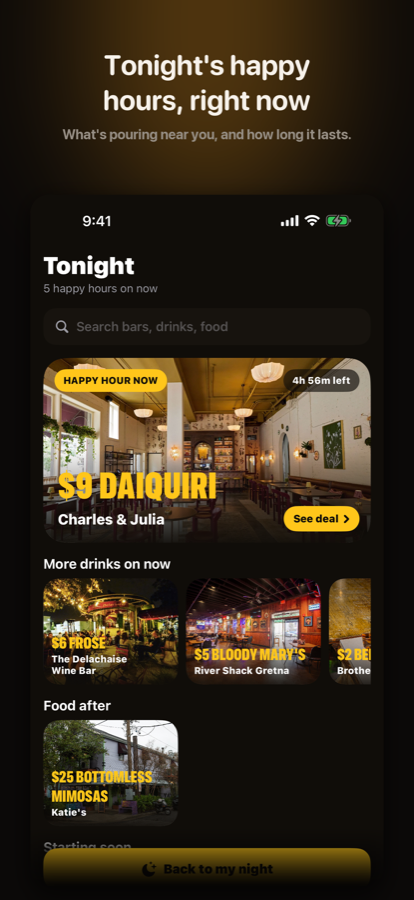
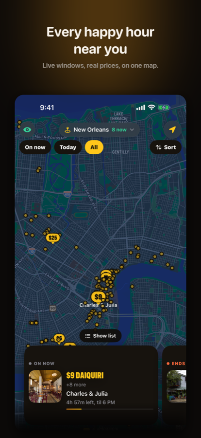
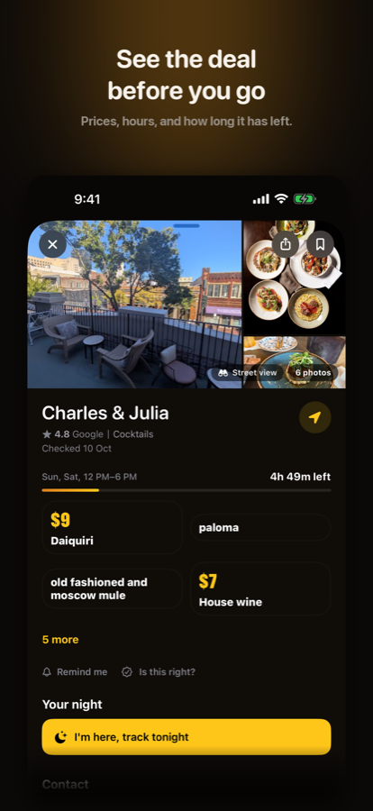
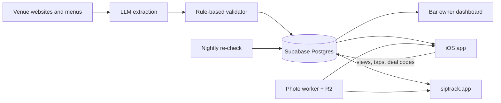

# SipTrack

A happy-hour finder. It shows which bars and restaurants near you have a deal on right now, what it costs and how long it lasts. 19,600+ venues with deals in 690+ US cities.

[siptrack.app](https://siptrack.app/) | [App Store](https://apps.apple.com/app/id6760595319) | [Sample bar dashboard](https://bars.siptrack.app/#/bar/sample-bar)

Built and run by [Benjamin Lesko](https://b-lesk.github.io/). This repo is an overview; the product source is private.

  
  
  

## How it fits together

| Part | Built with | What it does |
|---|---|---|
| iOS app | SwiftUI, SwiftData, iOS 17+ | Map and list of deals on now, venue pages, a night tracker with photos, friends and a feed. |
| Website | Next.js on Cloudflare Workers | A page for every city and venue, the same map on the web. |
| Bar dashboard | React, TypeScript, Vite on Cloudflare Pages | Owners see how many people viewed their deals, tapped toward a visit or used a deal code. |
| Database | Supabase Postgres | Row-level security on every table, numbered SQL migrations, server functions for anything that writes shared data. |
| Venue data | Gemini, Llama on Workers AI, Qwen run locally | Reads each venue's own site and returns days, times, items and prices as JSON. |
| Photos | Cloudflare Worker and R2 | Venue photos resized once and served from cache. |
| Operations | GitHub Actions, Cloudflare cron, Sentry, Resend | Nightly deal re-checks, weekly cleanup, health checks with an email digest, crash reports. |

## Getting deals right

A deal that's wrong is worse than no deal, so the model never writes to the database on its own.

- Every extracted deal goes through a deterministic check. The price and the item have to appear together on the source page, and the start and end times have to come from the same happy-hour section.
- Each night a job re-reads deals that are due, marks the ones still on the page as checked, and sends changes back through the same check.
- People can correct a deal in the app, by typing it or by photographing the menu. Corrections go through review before they replace anything.
- Times are stored as minutes after midnight with a list of weekdays, so "is this on right now" is a range check in the venue's own time zone, including windows that run past midnight.

## Running costs

The whole stack is built to stay near zero. Cloudflare and Supabase free and low tiers, capped spend on every paid service, the free Workers AI allowance for menu reading, and photos stored once instead of fetched per view.

## Running it

The source is private, so there's nothing to build here. Try the [site](https://siptrack.app/), the [app](https://apps.apple.com/app/id6760595319) or the [sample dashboard](https://bars.siptrack.app/#/bar/sample-bar).
