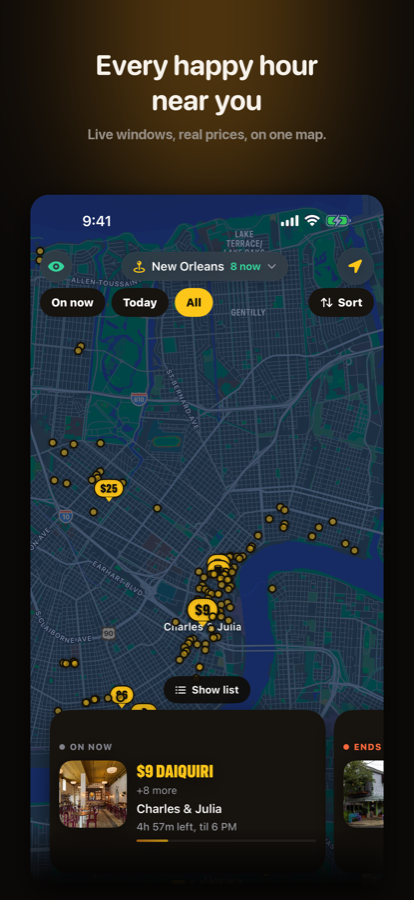
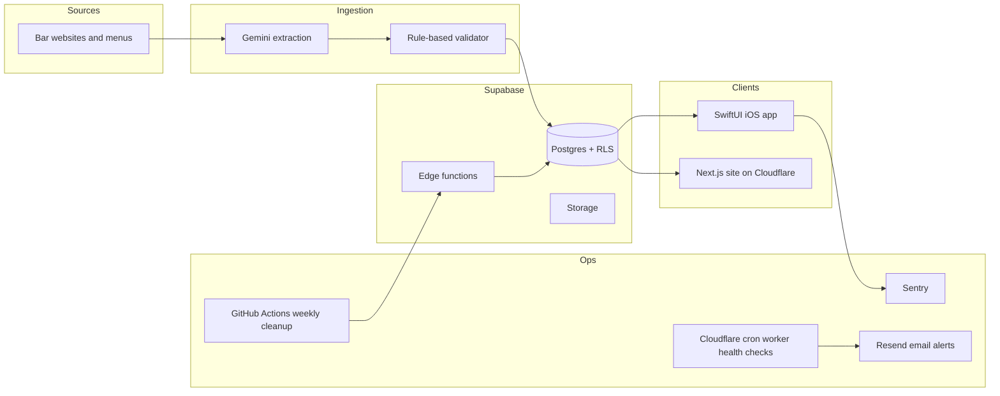

# SipTrack

A happy-hour discovery platform. It shows which bars near you have a deal on right now, what the deal is and how long it lasts.

- Live site: [siptrack.app](https://siptrack.app/)
- iOS app: [App Store](https://apps.apple.com/app/id6760595319)
- Status: live. Built and maintained by [Benjamin Lesko](https://b-lesk.github.io/)

This repo is a public overview. The product source is private because it holds production configuration, migrations and operations tooling.

  
  
  

## Architecture

| Layer | What it does |
|---|---|
| iOS app | SwiftUI and SwiftData, iOS 17+. Map, deal list, venue pages, night tracking, friends and chat. |
| Website | Next.js on Cloudflare, plus a static marketing site with Pages Functions for small APIs. |
| Backend | Supabase Postgres with row-level security policies, RPCs, edge functions and storage. |
| Venue data | Gemini reads each bar's own page and returns structured deals (days, start, end, items). A validator drops any deal it cannot match back to the page text. |
| Monitoring | Sentry in the app. A Cloudflare cron worker checks the live pages and APIs and emails a digest and alerts through Resend. A scheduled GitHub Actions job runs storage cleanup and an edge-function health check, and reports failures to Sentry. |

## Engineering notes

- Deal times are stored as minutes after midnight with day arrays, so "is this on right now" is a plain range check.
- Every extracted deal passes a deterministic gate. The price and item must appear together on the source page, and the start and end times must appear in the same happy-hour block.
- Schema changes are numbered SQL migrations, reviewed before they run in production.
- Large table reads use keyset paging, not deep offsets.

## Running it

The source is private, so there is nothing to build from this repo. Use the [live site](https://siptrack.app/) or the [App Store app](https://apps.apple.com/app/id6760595319).
